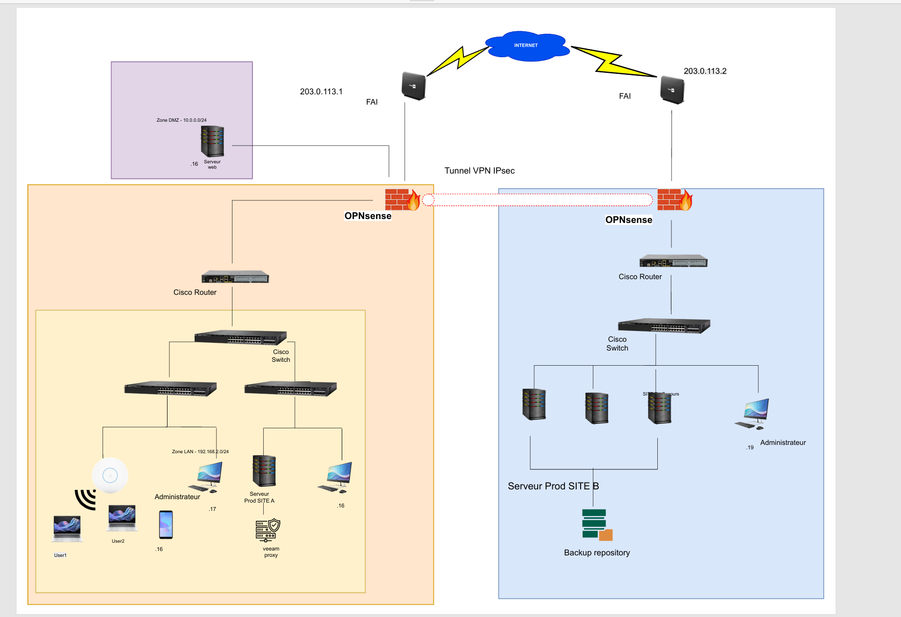

# 🛡️ Sauvegarde et restauration d'un serveur web Linux avec Veeam

## 📌 Présentation du projet

Ce projet porte sur la mise en place d'une solution
de sauvegarde et de récupération des données d'un
serveur web Linux hébergeant un service Apache2.

L'objectif est de protéger les données du serveur,
de les stocker sur un espace distant via NFS et
de permettre leur récupération en cas d'incident.

Le projet comprend le déploiement de Veeam Agent
for Linux, la configuration d'une sauvegarde,
puis une procédure de récupération des fichiers
avec vérification de l'accessibilité du site web.

## 🎯 Objectifs

- Mettre en place une stratégie de sauvegarde
  pour un serveur web Linux.
- Configurer Veeam Agent for Linux.
- Stocker les sauvegardes sur un serveur distant via NFS.
- Réaliser une procédure de récupération des fichiers.
- Vérifier le retour d'accès au service Apache2.

## 🏗️ Architecture

## 🛠️ Technologies utilisées

- **Linux (Ubuntu)** — Serveur web
- **Apache2** — Service web
- **Veeam Agent for Linux** — Sauvegarde et récupération
- **NFS** — Stockage distant des sauvegardes

## ✅ Résultats

La réalisation a permis de documenter :

- La configuration d'un travail de sauvegarde.
- L'exécution de la sauvegarde avec Veeam Agent.
- La présence des fichiers de sauvegarde
  sur le stockage NFS.
- La récupération des fichiers depuis la sauvegarde.
- L'accès au site web après récupération des données.

## 📄 Documentation technique

Les configurations, captures d'écran et étapes
de réalisation sont disponibles dans le manuel.

📘 [Consulter le manuel de déploiement](Manuel_de_Dploiement.pdf)

---

**KABIR IT | Réseaux • Systèmes • Infrastructures IT • Cybersécurité**
